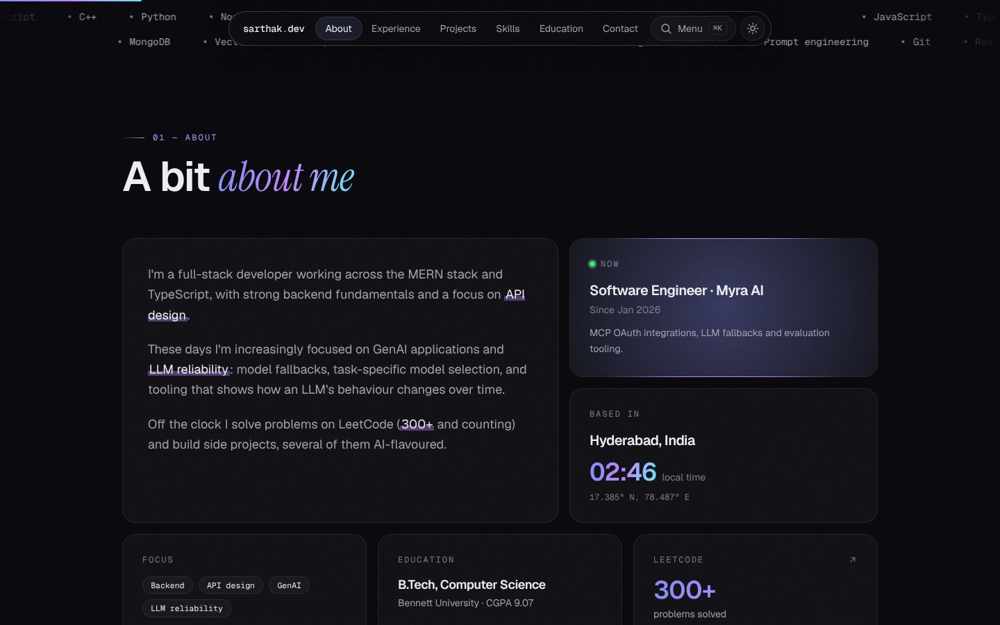
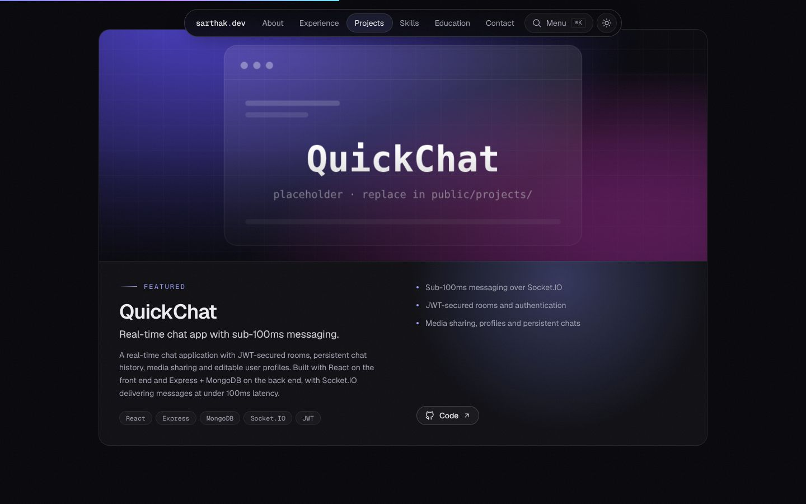
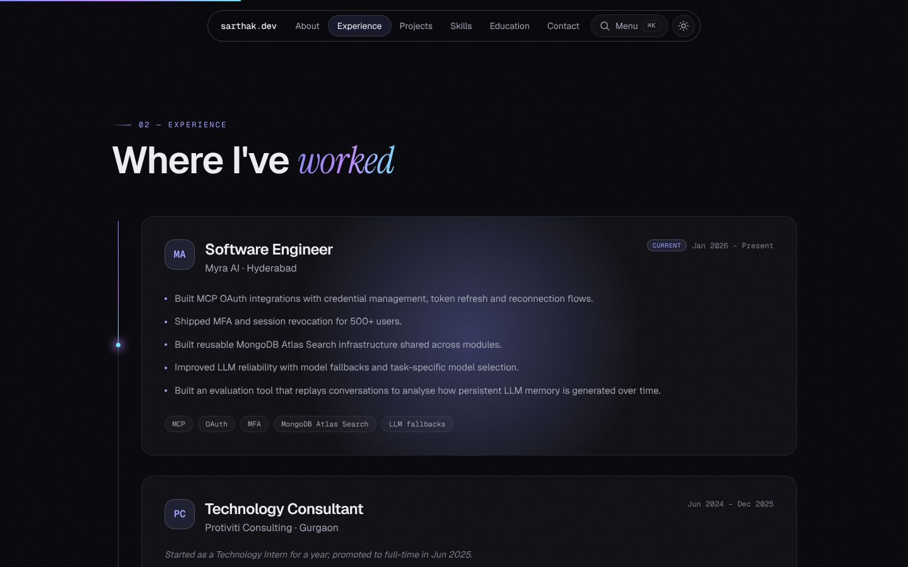
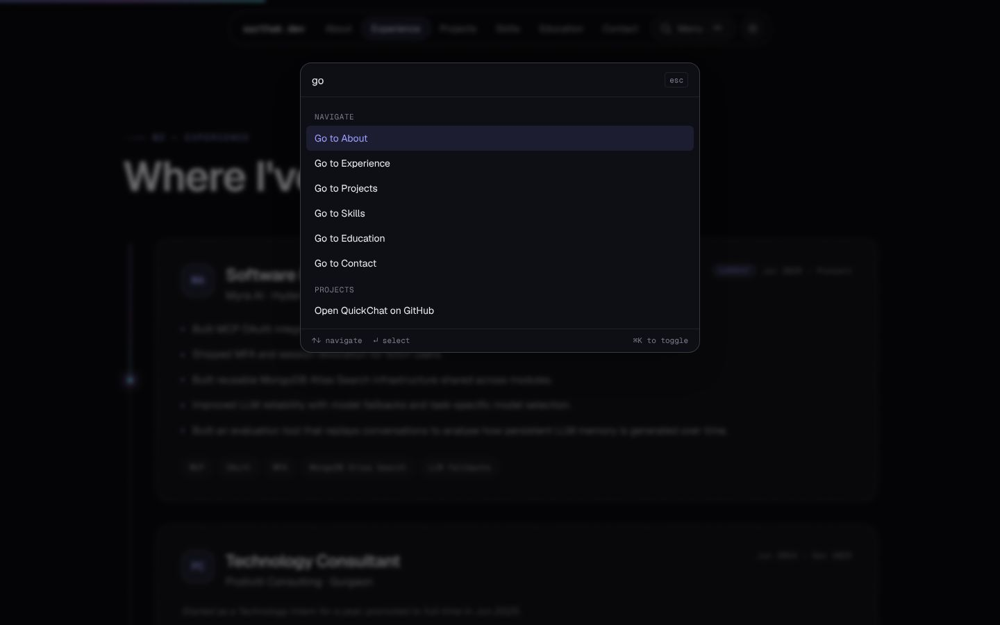
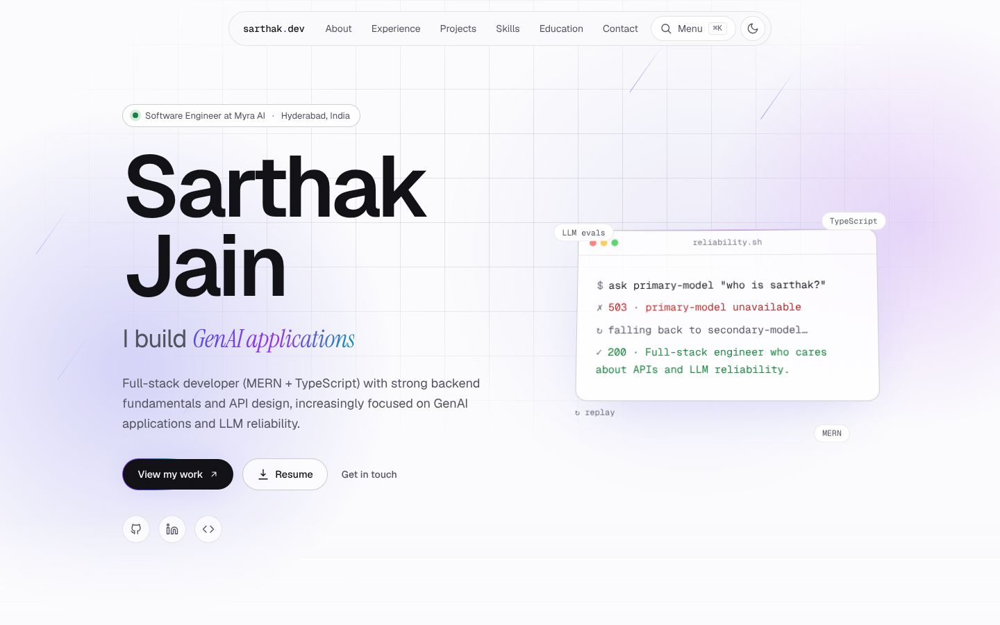

# Sarthak Jain — Portfolio

A dark-first, glassy personal portfolio with bento layouts, a floating nav, a command palette and a handful of playful interactions. Built with **Next.js, TypeScript and Tailwind**; Lighthouse 95–100; accessible; light/dark; deploy-ready for Vercel's free tier.


<p>
  
  
</p>
<p>
  
  
</p>
<p>
  
  
</p>

## Concept

**"Graceful fallback."** The design is elegant and typographic (Geist + an italic serif accent, one indigo→violet→cyan accent), and the playful bits riff on one idea from my work: LLM reliability — when the primary model fails, fall back gracefully. Design notes, the portfolios and component libraries that inspired it (incl. [vibrant.design](https://vibrant.design) and [Aceternity UI](https://ui.aceternity.com)) are in [`developer.md`](developer.md#concept--research).

## Features

- **Sections:** hero, stats + tech ticker, about (bento), experience (tracing beam), projects (featured + grid + in-progress rail), skills, education & achievements, contact
- **Hero:** aurora, light beam, grid, meteors, pointer spotlight, word-by-word name reveal, rotating "I build …" line, 3D-tilting terminal that plays out a model failover (replayable)
- **Glow cards:** borders and surfaces light up under the pointer
- **Floating pill nav** with a sliding active indicator and a scroll-progress bar
- **Command palette** — `⌘/Ctrl + K` (or `/`): jump anywhere, toggle theme, copy email, open repos
- **Easter eggs** — the Konami code, `sudo hire sarthak` in the palette, and a footer wordmark that reveals a gradient under your cursor
- **Dark / light mode**, no flash, remembers your choice (dark by default)
- **Accessible:** skip link, semantic landmarks, visible focus, keyboard-first palette, AA contrast
- **Respects `prefers-reduced-motion`** — all non-essential animation off
- **SEO:** metadata, canonical, generated Open Graph/Twitter image, JSON-LD, sitemap, robots
- **One typed content file** — edit [`src/data/site.ts`](src/data/site.ts) and everything updates
- **Resume download** button (`/resume.pdf`)
- Statically prerendered; no server, database or env vars required; **no animation/3D/UI libraries** — just CSS and small hooks

## Tech stack

Next.js 16 (App Router) · React 19 · TypeScript (strict) · Tailwind CSS 4 · Geist & Instrument Serif fonts (self-hosted) · ESLint 9

## Getting started

```bash
npm install
npm run dev
```

Open <http://localhost:3000>.

```bash
npm run check   # typecheck + lint
npm run build   # production build
npm start       # serve the production build
```

## Customise

1. Edit your content in [`src/data/site.ts`](src/data/site.ts) (profile, stats, experience, projects, skills, education).
2. Add your resume at `public/resume.pdf`.
3. Replace the placeholder images in `public/projects/` and update each project's `image` path.
4. Search for `TODO` in `src/data/site.ts` for anything still missing.

Full instructions: [`developer.md`](developer.md).

## Deploy

Import the repo at [vercel.com/new](https://vercel.com/new) — Next.js is auto-detected, no configuration needed. Optionally set `NEXT_PUBLIC_SITE_URL` to your final URL. Step-by-step in [`developer.md`](developer.md#deploy-to-vercel).

## Project structure

```
src/data/site.ts       all content (typed)
src/app/               layout, page, OG image, robots, sitemap, design tokens (globals.css)
src/components/        sections, hero, nav, command palette, project card
src/components/ui/     reusable effects: glow card, tilt, flip words, count-up, marquee, tracing beam, wordmark
src/lib/               small helpers
public/projects/       project images (placeholders — replace)
```
