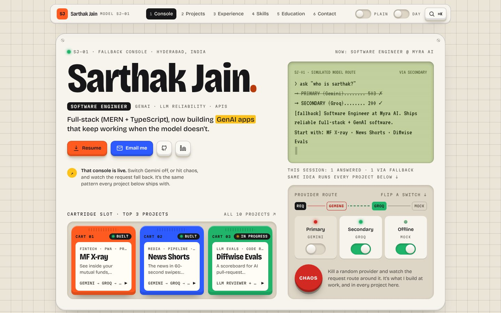
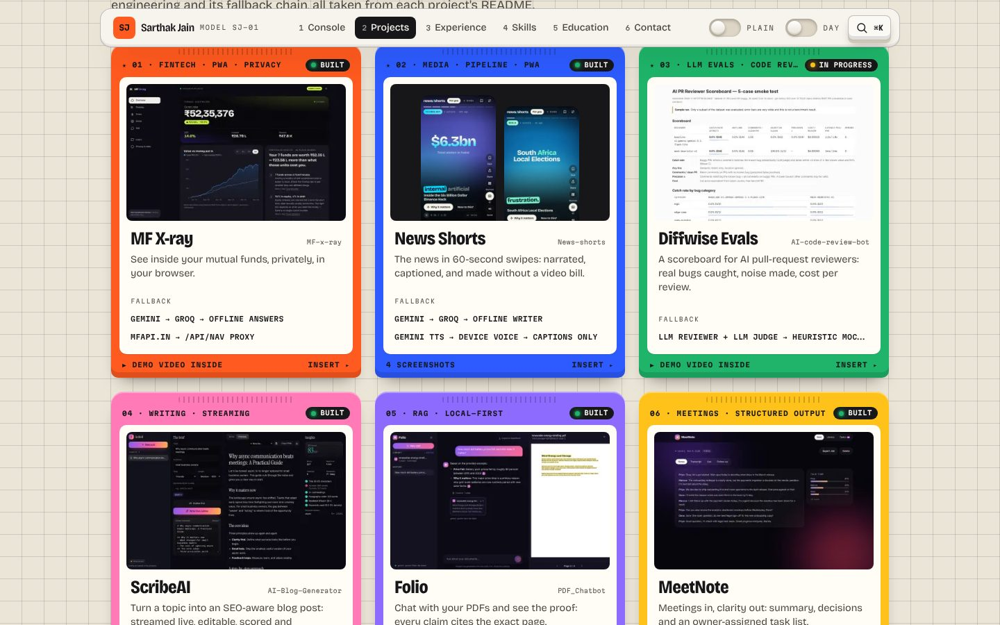
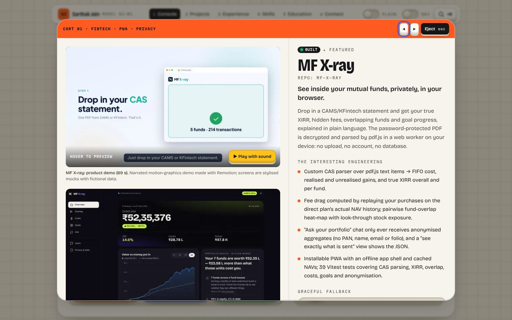
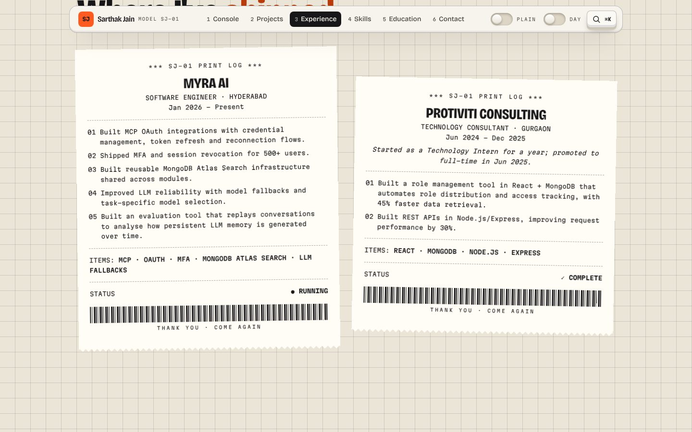
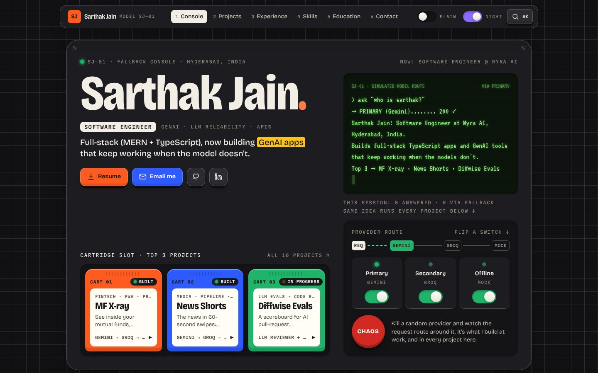
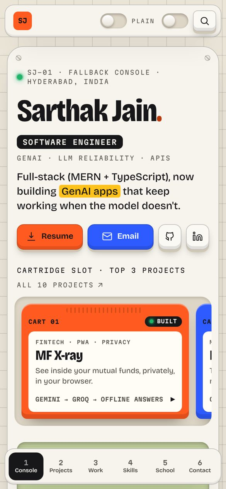
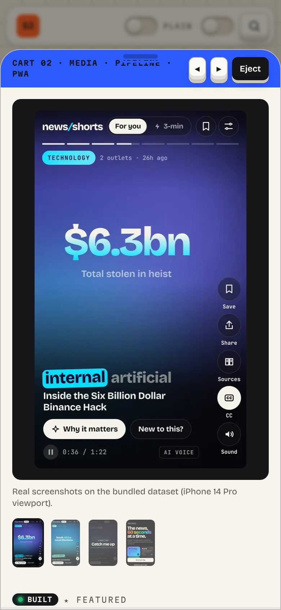
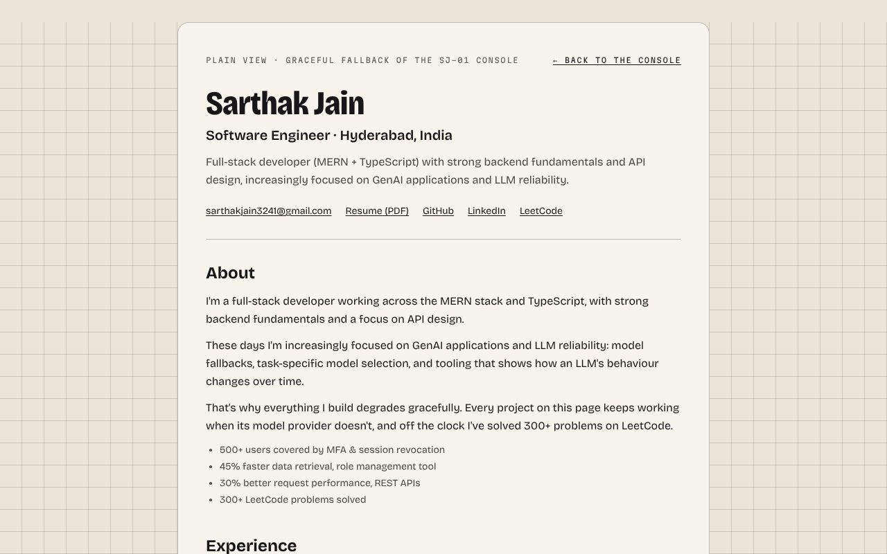

# Sarthak Jain: SJ-01 "Fallback Console" portfolio

A playful, tactile portfolio for a software engineer who works on **GenAI and LLM reliability**. The whole site is an instrument: flip the model-provider switches or hit **CHAOS**, and the console re-routes the request (Gemini → Groq → offline), so the answer still arrives. Turn everything off and it gracefully falls back to a plain-text résumé.

Every project on it really works that way: each cartridge is labelled with the fallback chain from that project's README.



<p>
  
  
</p>
<p>
  
  
</p>
<p>
  
  
  
</p>

## Features

- **Signature console:** an LCD streams an answer through a simulated provider route; three provider switches, a CHAOS button, a live route diagram and per-session counters. With every provider off it falls back to the plain view.
- **10-second test:** name, role, Resume/Email and the **top 3 projects** (MF X-ray, News Shorts, Diffwise Evals) are all on the first screen.
- **Projects as cartridges:** real screenshots, demo videos (lazy, muted hover preview, click for sound), the interesting engineering, stack, fallback chains, code links. The inspector is deep-linkable (`#project-mf-xray`); on phones it's a bottom sheet.
- **Experience as receipts** that print on scroll. **Skills as keycaps**: press one to see which projects use it. **Achievements as stickers** you can drag.
- **Plain view** at `/plain`: every word, no JS, printable. Cartridge links fall back to it without JavaScript.
- **Day (default) and night themes**, characterful type (Bricolage Grotesque, Martian Mono, VT323), all self-hosted.
- **Keyboard first:** real buttons and switches, keys **1–6** for channels, **⌘K** palette, Esc/Back closes the inspector. And there's a Konami code…
- **Accessible and fast:** Lighthouse 99–100 in every category, 0 axe violations in both themes, and `prefers-reduced-motion` respected everywhere.
- **SEO:** metadata, canonical, a generated OG image, JSON-LD, sitemap and robots.

## Tech

Next.js 16 (App Router, fully static) · React 19 · TypeScript (strict) · Tailwind CSS 4 · @fontsource fonts · no UI, animation or 3D libraries.

## Getting started

```bash
npm install
npm run dev
```

```bash
npm run check   # typecheck + lint
npm run build   # production build
```

## Customise

- All content lives in [`src/data/site.ts`](src/data/site.ts) (typed by [`src/data/types.ts`](src/data/types.ts)).
- Put your résumé at `public/resume.pdf`.
- Search `TODO` in `site.ts` for missing live links.
- Re-import screenshots and videos from the project repos with `scripts/import-assets.py`.

Concept, research, screenshot critique, data sources, decisions and deploy steps are in [`developer.md`](developer.md).

## Deploy

Import the repo at [vercel.com/new](https://vercel.com/new); no configuration is needed. Optionally set `NEXT_PUBLIC_SITE_URL`.
