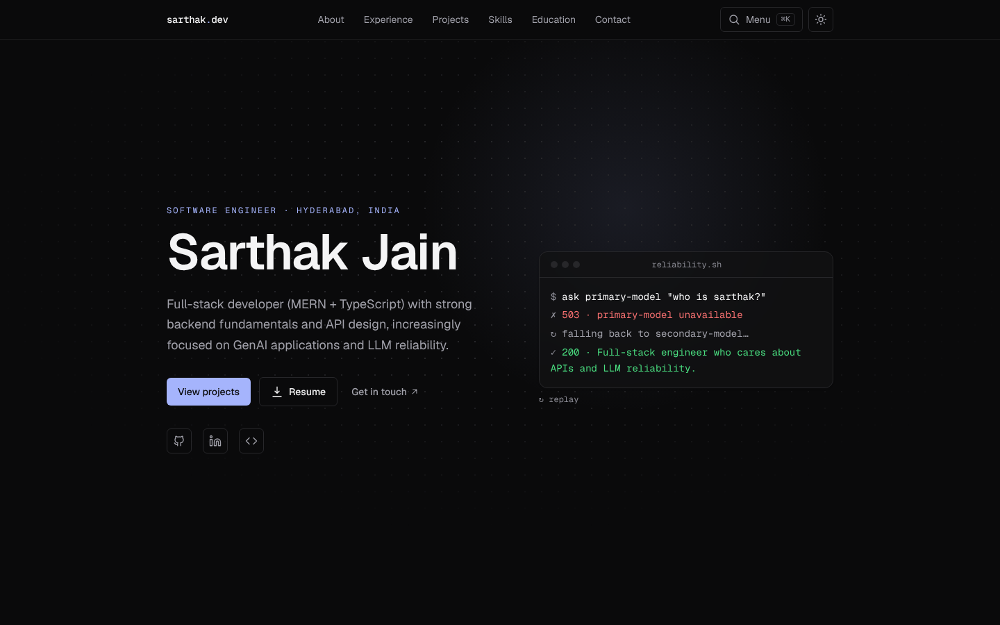
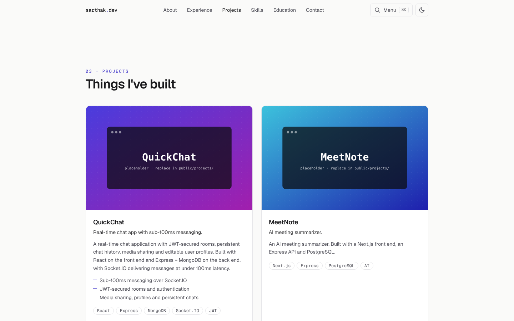
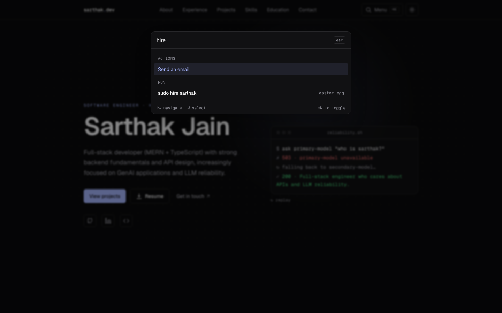

# Sarthak Jain — Portfolio

A clean, minimal personal portfolio with a few playful touches, built with **Next.js, TypeScript and Tailwind**. Fast (Lighthouse 98–100), accessible, dark/light, and deploy-ready for Vercel's free tier.



<p>
  
  
</p>

## Concept

**"Graceful fallback."** The design is quiet and typographic, and the interactive bits all riff on one idea from my work: LLM reliability — when the primary model fails, fall back gracefully. Design notes and the portfolios that inspired it are in [`developer.md`](developer.md#concept--research).

## Features

- **Sections:** hero, about, experience, projects (shipped + in progress), skills, education & achievements, contact
- **Command palette** — `⌘/Ctrl + K` (or `/`): jump anywhere, toggle theme, copy email, open repos
- **Hero terminal** that plays out a model failover (replayable), plus a pointer-reactive spotlight
- **Easter eggs** — try the Konami code, or `sudo hire sarthak` in the palette
- **Dark / light mode** with no flash, remembers your choice, follows the OS by default
- **Accessible:** skip link, semantic landmarks, visible focus, keyboard-first palette, AA contrast
- **Respects `prefers-reduced-motion`** — all non-essential animation off
- **SEO:** metadata, canonical, generated Open Graph/Twitter image, JSON-LD, sitemap, robots
- **One typed content file** — edit [`src/data/site.ts`](src/data/site.ts) and everything updates
- **Resume download** button (`/resume.pdf`)
- Statically prerendered, no server, no database, no env vars required

## Tech stack

Next.js 16 (App Router) · React 19 · TypeScript (strict) · Tailwind CSS 4 · Geist fonts · ESLint 9. No animation or UI libraries.

## Getting started

```bash
npm install
npm run dev
```

Open <http://localhost:3000>.

```bash
npm run check   # typecheck + lint
npm run build   # production build
npm start       # serve the production build
```

## Customise

1. Edit your content in [`src/data/site.ts`](src/data/site.ts) (profile, experience, projects, skills, education).
2. Add your resume at `public/resume.pdf`.
3. Replace the placeholder images in `public/projects/` and update each project's `image` path.
4. Search for `TODO` in `src/data/site.ts` for anything still missing.

Full instructions: [`developer.md`](developer.md).

## Deploy

Import the repo at [vercel.com/new](https://vercel.com/new) — Next.js is auto-detected, no configuration needed. Optionally set `NEXT_PUBLIC_SITE_URL` to your final URL. Step-by-step in [`developer.md`](developer.md#deploy-to-vercel).

## Project structure

```
src/data/site.ts     all content (typed)
src/app/             layout, page, OG image, robots, sitemap, design tokens
src/components/      sections, command palette, hero, theme toggle
src/lib/             small helpers
public/projects/     project images (placeholders — replace)
```
